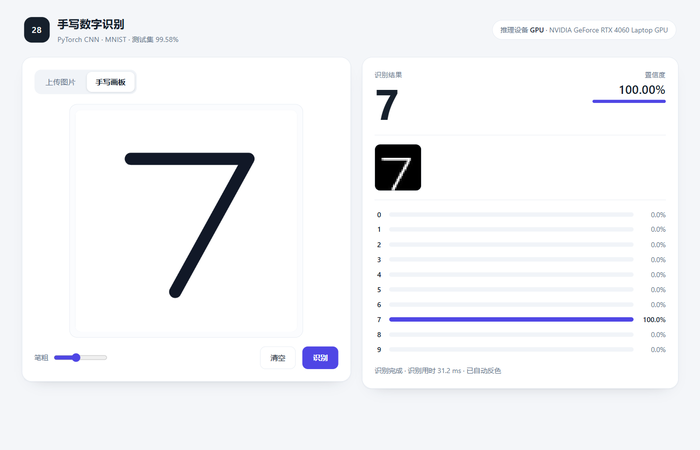

# 手写数字识别 Web 演示



把 `part2/best_mnist_cnn.pth` 包成一个网页：左边上传图片或直接用鼠标写数字，右边实时显示识别结果、置信度、模型真正看到的 28×28 输入，以及 10 类的概率分布。

## 环境

- Python 3.10+
- PyTorch（有 CUDA 会快很多，纯 CPU 也能跑）
- Flask、Pillow、numpy

```bash
pip install -r requirements.txt
```

## 准备权重

仓库里没有 `best_mnist_cnn.pth`（`.gitignore` 排除了权重和数据集）。先跑一次 `part2/cnn_training.py` 训练出来：

```bash
cd part2
python cnn_training.py
```

或者把自己的 `best_mnist_cnn.pth` 放到 `part2/` 目录下（和 `cnn_training.py` 同级）。

## 运行

```bash
cd part2/webapp
python app.py
```

浏览器打开 <http://127.0.0.1:5000> 。启动时会加载权重并跑一次空输入预热，避免第一次点击卡在 CUDA 初始化上。

## 三个功能

- **上传图片**：点选、拖进虚线框，或者 Ctrl+V 直接粘贴剪贴板里的截图。
- **手写画板**：鼠标或触屏书写，抬笔 260ms 自动识别，也可以点「识别」或按 Ctrl+Enter；笔粗可调。
- **试一个测试集样本**：随机抽一张 MNIST 测试图，用来区分「模型本身不行」和「我的输入不对」。需要 `part2/data/MNIST/raw/` 下有测试集文件（跑一次 `cnn_training.py` 会自动下载）。

## 接口

| 方法 | 路径 | 说明 |
| --- | --- | --- |
| GET | `/api/health` | 推理设备、显卡型号、torch 版本 |
| POST | `/api/predict` | 传 `file`（文件）或 `image`（dataURL），返回 digit / confidence / probs / preview / bbox / elapsed_ms |
| GET | `/api/example?label=7` | 一张测试集样本的 PNG dataURL 与真实标签 |

`/api/predict` 失败时返回 4xx 加 `{"ok": false, "error": "..."}`，例如空白画板会得到「图片对比度太低，没找到可以识别的笔画」。

## 预处理与 `predict_digit.py` 的差别

原脚本是「整体缩放到 28×28 再标准化」，对画板这种笔画大小、位置都随意的输入不够稳。这里按 MNIST 的原始制作方式重新做：

1. 裁到笔画的包围盒，去掉大片空白；
2. 等比缩放到 20×20，保留长宽比，不把「1」拉成方块；
3. 贴进 28×28 的中心，再按质心平移到 (14, 14)；
4. 白底黑字自动反色，最后用训练时的均值 0.1307、标准差 0.3081 标准化。

这样画板、手机照片、屏幕截图三种来源都能对齐到训练分布。空白或对比度太低的图直接报错，不会硬猜一个数字。

## 文件

```
webapp/
  app.py              Flask 路由
  model.py            ImprovedCNN（与 cnn_training.py 逐层一致）与权重加载
  preprocess.py       图像预处理，返回模型输入和调试信息
  templates/index.html
  static/style.css
  static/app.js
  docs/preview.png    界面截图
```

`model.py` 里的网络结构必须和 `cnn_training.py` 完全一致，否则 `load_state_dict` 会报 key 不匹配。

## 性能

单张推理在 RTX 4060 Laptop 上约 20 ms（GPU 前向只要 4 ms 左右，其余是预处理和传输）。如果页面顶部显示的是 CPU，那是在用 CPU 推理，会慢一个数量级。
